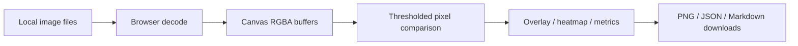

# Screenshot Diff Lab

Compare two game or application screenshots locally. Review images side by side, blend them with an adjustable overlay, or inspect a thresholded pixel-difference heatmap. Export the heatmap as PNG and the measured summary as JSON or Markdown.

**No installation, runtime dependencies, uploads, or external image services.** The app processes images in your browser tab. It supports PNG, JPEG, WebP, and BMP up to 10 megapixels per image.

## Open the app

Open `index.html` in a current browser. If the browser blocks JavaScript modules from `file://`, start a local static server from this folder:

```powershell
python -m http.server 8000
```

Then open <http://localhost:8000>.

The hosted version is also available at <https://ghostnever-lkm.github.io/screenshot-diff-lab/>.

## Compare screenshots

1. Load a baseline and a current image, or choose **Load sample pair** to try the interface.
2. If the dimensions differ, select which image should be stretched to the other image's dimensions. Resizing can affect pixel metrics.
3. Switch between side-by-side, overlay, and difference views.
4. Adjust the threshold. A pixel is marked changed when its largest absolute RGBA channel difference is greater than that threshold.
5. Review changed-pixel count, changed-area percentage, mean absolute error, and the bounding rectangle. Export the heatmap or summary if useful.

The metric is a raw pixel comparison. It cannot tell whether a visual change is intentional, meaningful, or a defect. Browser decoding and color management may also affect results. Inspect the source images before drawing conclusions.

## What is in the report

JSON and Markdown exports include the two file names, source dimensions, comparison dimensions, chosen resize mode, threshold, number and percentage of changed pixels, mean absolute error, and changed bounds. They do not embed image pixels or file contents.

## Development

No package install is needed for tests; Node.js 20+ can run:

```powershell
npm test
```

`diff-core.js` is the pure pixel comparison module. `app.js` handles image decoding, canvas rendering, user controls, and exports. GitHub Actions deploys the static app to Pages and creates a ZIP release with a SHA-256 sidecar.



## ☕ Support / Pro Version

Screenshot Diff Lab is free and MIT-licensed. There is no paid Pro edition at this release. If the tool is useful, you can support GhosTnever on [Boosty](https://boosty.to/azizazimov) or [Buy Me a Coffee](https://buymeacoffee.com/azizazimov8). Support is optional; the comparison features are available without payment.

## License

MIT. See [LICENSE](LICENSE).
